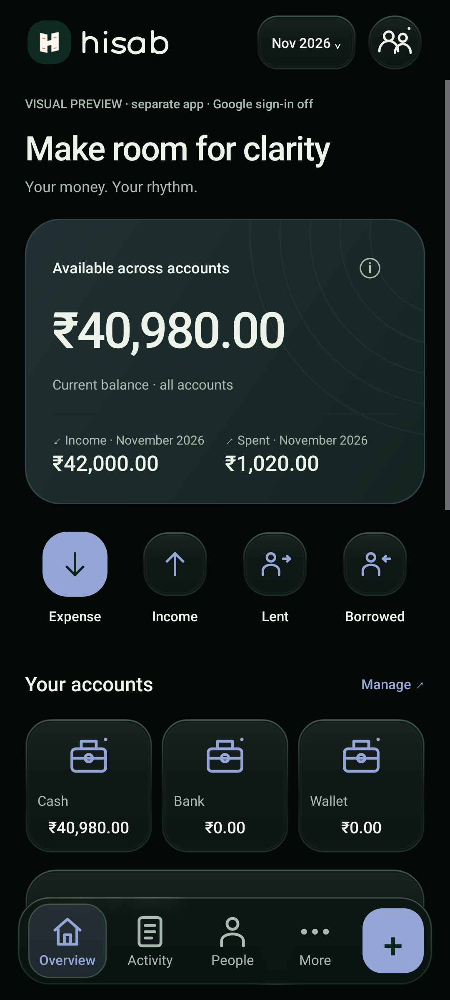
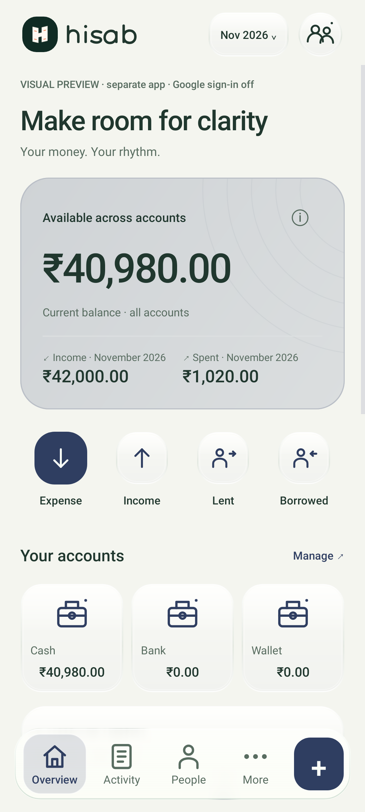
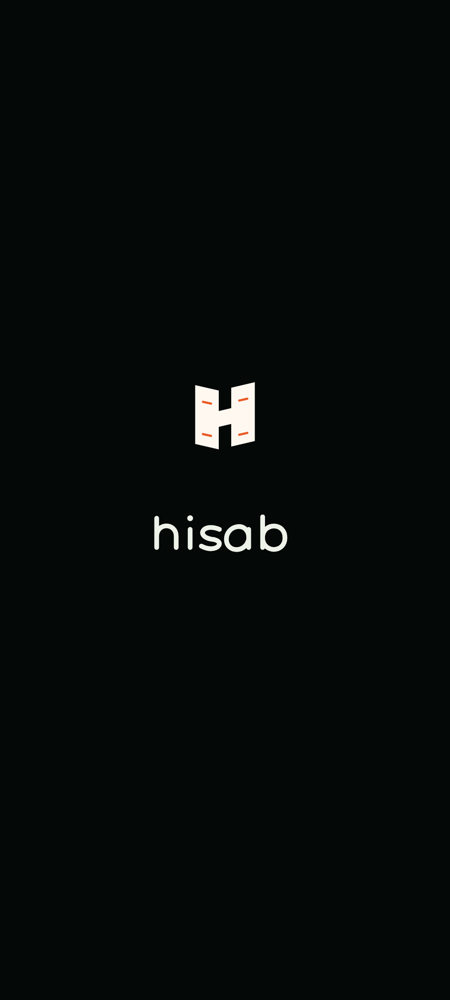

# Hisab 0.3.0 visual preview

This is a separate app called **Hisab Preview**, package `in.aicon.hisab.visualpreview`. It does not replace the installed Hisab preview, read its records, or share its data. Do not uninstall the existing Hisab. Use sample data in this build.

Google sign-in and Drive sync are unavailable in the visual-preview APK. The normal source build keeps the original `in.aicon.pocket.test` application ID and Google/Drive implementation. The old preview signing key could not be recovered, so no same-package update is published with a different key. Production signing and the next Google OAuth client registration remain separate decisions.

## Changed

- Brief original Hisab logo/wordmark reveal on a new launch. Adds at most about 800 ms, independent of network access. Does not replay on a recreated activity or a reminder deep link. Android's animation-off setting skips it.
- Balance card with original contour details, stronger amount hierarchy and clearer spacing.
- Larger centred quick-entry controls, with different receive/pay directions for lent and borrowed.
- Short, staggered page entrances, no perpetual background animation. Reduced motion keeps content immediately visible.
- All existing ledger features, customisation, languages, themes, backup and export retained. No tracking or server added.

## Verified

APK built with Java 17, Gradle 8.14.3 and Android SDK 36. Signature, separate package, launcher label, versionCode 6 and packaged permissions checked. No SMS permission. The APK uses a new development/debug certificate for this separate package only.

104 distinct passing Android-framework simulation methods across 11 classes were rerun for this change: all 42 existing LocalUiTest methods, selected ledger/account/sync/backup/repayment suites, 4 new polish tests, and the variant-boundary test. The four polish tests plus the variant test also pass against the actual visual-preview build. Earlier 128-method results remain historical, not a claim of a full current rerun.

Inspected native renders of light/dark Home, launch, entry, reports, settings, and 1.4x Malayalam. Sample balances are synthetic. This is not real-phone testing. Real install, Play Protect, keyboard/insets, touch feel, launch performance and Android background behavior still need a phone check. Do not disable Play Protect to install it.

APK SHA-256:
`717c0feb2daf89da31a70d6272124fc648e5e081764a910993b0799ad3696e3f`

Build the side-by-side variant:

```sh
./gradlew -PvisualPreview :app:assembleDebug
```

Do not publish an APK built without `-PvisualPreview` using a new key as an update to the existing app.

## Native renders

Synthetic sample data, framework renders rather than device photos.


