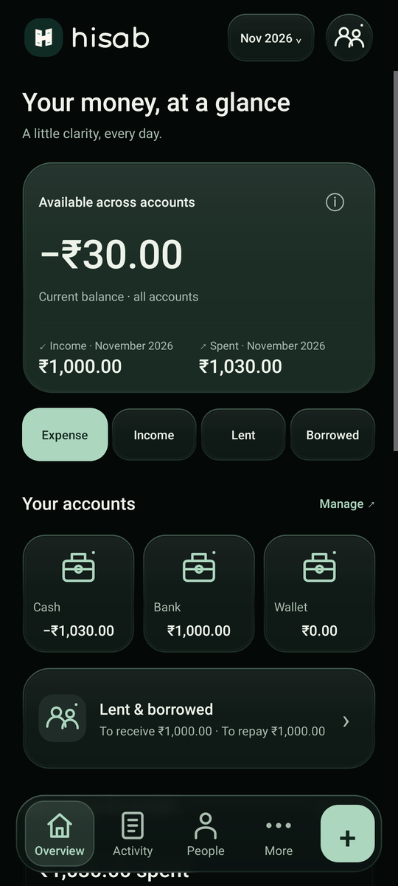
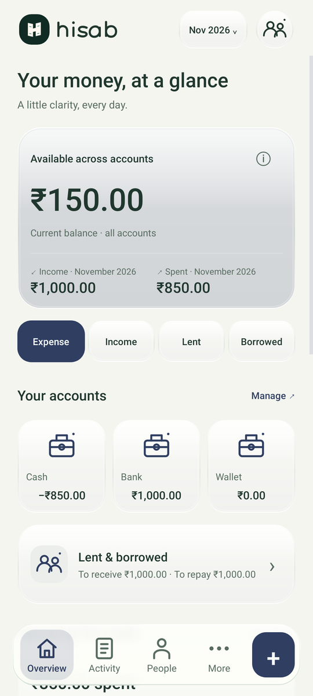
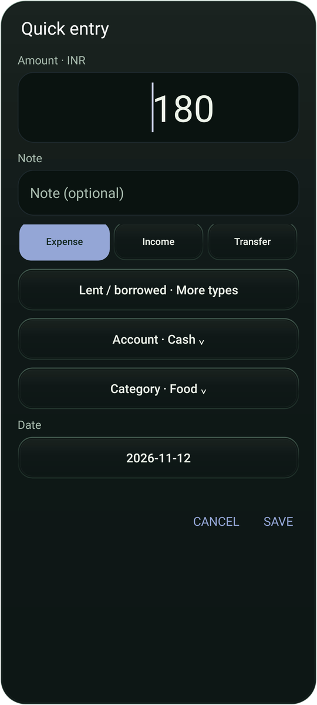
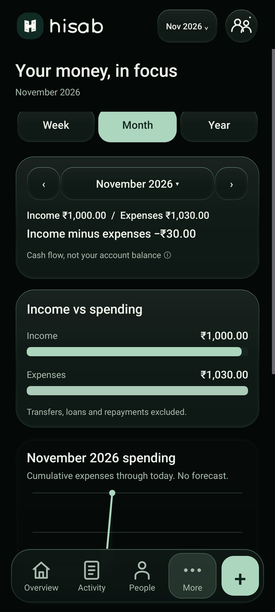

<p align="center"></p>

<p align="center">A local-first Android ledger for everyday money, lent and borrowed balances, and a calmer view of your finances.</p>
<p align="center"><a href="#what-feels-different">Why Hisab</a> · <a href="#all-features">All features</a> · <a href="#screens">Screens</a> · <a href="#version-history">Version history</a> · <a href="#build">Build</a></p>

> **Development preview, not production-ready.** Latest published build: [0.2.3-dev](https://github.com/aicon-hub/hisab/releases/tag/v0.2.3-dev). Use sample data and keep a separate encrypted backup. Phone installation, Play Protect, Google/Drive and OS background behaviour still need real-device checks.

## What feels different

Hisab puts a few deliberate choices together. These describe its design, not a claim that no other app offers them.

| Design choice | What it means in daily use |
| --- | --- |
| Balance first, entry close by | Home opens on available money and accounts. Expense, income, lent and borrowed shortcuts and a floating add action keep the next step nearby. |
| Amount before a wall of fields | Quick entry starts with the amount. Account/category choices expand when needed; validation still happens before saving. |
| Debt is not spending | Lent, borrowed, transfers and repayments stay separate from income/expense charts. A person's ledger shows what is owed and the running balance. |
| A message you review, not a message sent for you | A saved debt can open its person's ledger and a WhatsApp review action. Check the person and words, then send in WhatsApp/SMS yourself. |
| Appearance that follows you | Light, revised near-black dark and On device modes; reflective Glass surfaces, a blurred floating dock, dynamic colour, fonts and configurable Home sections. |
| Local without an account | Start on the phone, with no sign-up. Optional own-Drive ledgers are separate; signing in alone does not upload local records. |

Rather than starting with bank linking, automatic SMS capture or a busy dashboard, Hisab starts with manual entry and a compact balance-first screen. Its visual direction is soft reflective surfaces, larger centred icons and progressive controls. It does not promise to be faster or better than another app; real-phone usability and performance testing remain pending.

## All features

| Area | Included in 0.2.3-dev |
| --- | --- |
| Everyday ledger | Manual income, expense and transfers; accounts and categories, including custom choices; notes and dates; search, edit and confirmed delete; day-grouped activity and daily totals. |
| Money planning | Budgets, savings goals, equal splitting, account balances and monthly income/expense/net summaries. Net cash flow is not the same as account balance. |
| Lent & borrowed | People ledgers, separate receive/pay figures, chronological running balances, linked repayments and principal-limit checks; optional phone-only contact links and pay-by notes. |
| Reports | Weekly daily-expense bars with values; monthly income/spending, cumulative expenses and category breakdown; yearly cumulative expenses and monthly values. Transfers, loans and repayments are excluded. |
| Personalisation | Light/dark/On device, optional pure-black override, light/dark Glass, toned dynamic colour and selected palettes; launcher colours, Home order, entry defaults, icons and number/date/currency formatting. Formatting is not multi-currency accounting. |
| Type & language | System default first; bundled Comfortaa Medium, Inter, Lora and Poppins. English/Malayalam UI, with Android fallback for missing scripts. The Hisab wordmark is original path-drawn lettering. |
| Private profile | Optional round photo and display name; grouped appearance, data and money-control settings. |
| Reminders & messages | Optional morning/evening generic local reminders and overdue alerts; reviewed SMS/WhatsApp with current amount/date. Off by default, no automatic sending. Android can delay alerts. |
| Backup & export | Password-encrypted backup/restore with supported settings; readable CSV and printable PDF. PDF is a raster statement, not searchable text. CSV/PDF are not restore backups. |
| Optional own-Drive | Selected-user private ledger sync through hidden Drive app data. Separate from local-only records, not person-to-person sharing. Enabled in this preview but phone-unverified; Google remains Testing-only. |
| Local hints | English-only rule-based category suggestions that require confirmation. No bundled AI model and no real-world accuracy claim. |
| No extras you did not ask for | No ads, analytics, bank connection, loan offers, referral schemes, automatic SMS reading/sending, accessibility capture or notification listener. No AiCoN ledger server. |

## Screens

Native Android-framework renders with synthetic sample records, not photographs from a tested phone. Light and dark samples use different records; do not compare their balances. Minor device rendering differences remain unverified.

<table><tr><td align="center"><br>Near-black Home</td><td align="center"><br>Light Home</td><td align="center"><br>Amount-first entry</td><td align="center"><br>Monthly reports</td></tr></table>

## Version history

Short changes by release, with full caveats in each linked release. An older release's feature can be removed later: automatic SMS from 0.2.1 is **not** in the current app.

| Version | What changed |
| --- | --- |
| [0.2.3-dev](https://github.com/aicon-hub/hisab/releases/tag/v0.2.3-dev) | Compact balance-first Home; larger centred icons and floating add action; light/dark Glass and revised near-black dark surfaces; amount-first progressive entry; debt-save-to-person-ledger WhatsApp review; weekly/monthly/yearly charts; grouped Profile. Reduced-resolution dock capture, bitmap disposal and query work, without a device-speed claim. |
| [0.2.2-dev](https://github.com/aicon-hub/hisab/releases/tag/v0.2.2-dev) | Removed automatic SMS completely, including SEND_SMS, callbacks and controls. Kept reviewed messaging and optional local alerts. Added public homepage/privacy sources; OAuth stayed Testing-only. This did not prove Play Protect acceptance. |
| [0.2.1-dev](https://github.com/aicon-hub/hisab/releases/tag/v0.2.1-dev) | Original wordmark/profile; bundled fonts; On device appearance and dark Glass dock; richer month/day reports and charts; people/pay-by/reminder flows; PDF export and customisation-aware encrypted backups. Enabled optional Google/Drive in the APK. Experimental off-by-default automatic SMS was introduced here, then removed in 0.2.2. |
| [0.2.0-preview](https://github.com/aicon-hub/hisab/releases/tag/v0.2.0-preview) | Dynamic light/dark, pure-black option and separate dark Glass preview. Google/Drive implementation was present in source but **disabled in that APK**, which had no INTERNET permission. First published Gradle-source preview. |
| [0.1.0-test](https://github.com/aicon-hub/hisab/releases/tag/v0.1.0-test) | Original offline Java/SQLite prototype: income/expenses/transfers, Cash/Bank/Wallet, budgets, goals, monthly reports, search/edit/delete, equal splitting, CSV, English/Malayalam, local category hints and encrypted-backup implementation. Separate test package; built directly with Android tools. App source was a release attachment, not the automatic repository source archive. |

No production release has been published. A passing build or simulation is not a physical-device test.

## Try the preview safely

- Android 8.0+ (API 26). Test package: `in.aicon.pocket.test`, versionCode `5`. This is separate from the AiCoN reader.
- Download only from the linked [0.2.3-dev release](https://github.com/aicon-hub/hisab/releases/tag/v0.2.3-dev). Preview/debug signing, not a production release key.
- Back up important records first. For an in-place update, keep the same package/certificate and **do not uninstall first**: uninstalling deletes local data. Upgrade/data retention still need a phone check.
- Do not turn off Play Protect to install. Removing SMS capabilities reduces permissions; it does not guarantee acceptance.

0.2.3-dev APK SHA-256:

```text
2cf168e7b2b65cbad666e9aebf28df1547343d6e287db824822eb51e4b86dd43
```

## Privacy & sync boundaries

- Local-only is the default. Google sign-in alone does not copy local data. Explicit ledger-copy and account checks are required.
- Drive app data is **not application-encrypted backup**. Use encrypted file backup for that separate purpose.
- Profile name/photo, chosen contact links and pay-by notes remain phone-only and outside Drive/backup. Supported appearance/default/reminder settings are in encrypted backup; Android permissions are not restored by a backup.
- Contacts permission is requested when choosing a contact, notifications when enabling alerts. Network access supports the optional Google/Drive path. No SEND_SMS or SMS-reading permission.
- Selected-ledger edits request coalesced sync; background work is subject to Android, network and battery limits. It is not instant delivery or live shared accounting.
- No calendar view, automatic bank import, voice/receipt AI or multi-currency ledger. Reviewed messaging uses another app and may incur carrier/data charges.

[Homepage](https://aicon-hub.github.io/hisab/) · [Privacy policy](https://aicon-hub.github.io/hisab/privacy.html)

## Build

Java 17, Gradle 8.14.3, Android Gradle Plugin 8.13.2, Android SDK platform 36. Target API 35, minimum API 26. Set `ANDROID_HOME` or an untracked `local.properties` with `sdk.dir`.

```sh
./gradlew :app:assembleDebug
./gradlew :app:testDebugUnitTest
```

Dependencies are pinned by version in Gradle and resolved from Google Maven/Maven Central. The wrapper distribution has a SHA-256 check. No SDK, credentials, signing keys, private build overrides or caches belong in the repository. A debug build without private overrides succeeded at the documentation checkpoint; this is **not** proof of byte-for-byte reproducibility or a clean-machine build.

Google's Android OAuth client is tied to a package and signing certificate. A different developer/debug key cannot silently reuse the registered preview client. Client IDs are public configuration, never client secrets.

## Verification & readiness

At 0.2.3-dev: 128 distinct framework-simulation methods across 18 classes passed in bounded groups, including 42 UI methods. Signature and packaged permissions were checked; native renders were inspected. See [VERIFICATION.md](VERIFICATION.md) and [STATUS.md](STATUS.md) for scope.

Still pending on a real phone: install/Play Protect, Google sign-in and own-Drive round trip, account switch/revoke/reset recovery, Contacts/photo pickers, upgrade/data retention, keyboard/insets, reviewed-message handoff, notification/reboot/background behaviour and performance. There is no claim of a phone QA pass, store acceptance, or reproducible release.

Store metadata preparation is in `fastlane/metadata/android/en-US/`. It does not mean a listing has been requested or approved. No F-Droid or other store submission has been made as part of this update.

## Licence

Hisab's original code and original project assets are licensed under **GNU GPL version 3**. See [LICENSE](LICENSE). The code licence was selected on 12 November 2026; older release notes accurately describe the earlier unlicensed state at publication time.

Bundled Comfortaa, Inter, Lora and Poppins retain their own SIL Open Font License 1.1 notices in [`app/src/main/assets/font-licenses/`](app/src/main/assets/font-licenses/). Third-party libraries and Gradle tooling retain their respective licences. This grant does not claim ownership of those components or provide trademark clearance for the name.
